# Exercise 3 — Component hierarchy for the whole app (Demo 7)

Legend: **[built]** exists in `react/` after Exercise 3 · **[Ex 4]** / **[Ex 5]** planned.

## Diagram

```mermaid
flowchart TD
  App["App [built]"] --> Providers["CaseDataProvider [built] (later: + BookmarksProvider, NotesProvider)"]
  Providers --> Shell["Shell"]
  Shell --> Header["Header [built]"]
  Header --> Brand["Brand/logo [built, inline in Header]"]
  Header --> NavBar["NavBar [built]"]
  Shell --> Main["Router outlet (PAGES table) [built]"]
  Shell --> Footer["Footer [built]"]

  Main --> DashboardPage["DashboardPage [built]"]
  Main --> EvidencePage["EvidencePage [Ex 4]"]
  Main --> PeoplePage["PeoplePage [Ex 4]"]
  Main --> TimelinePage["TimelinePage [Ex 5]"]
  Main --> WorkspacePage["WorkspacePage [Ex 5]"]

  DashboardPage --> HowToUseCard["HowToUseCard [built]"]
  DashboardPage --> CaseSummaryCard["CaseSummaryCard [built]"]
  DashboardPage --> StatGrid["StatGrid [built]"] --> StatCard["StatCard [built]"]
  DashboardPage --> ReviewProgress["ReviewProgress [built]"] --> ProgressBar["ProgressBar [extract Ex 4]"]
  DashboardPage --> RecentEvidenceList["RecentEvidenceList [built]"]
  DashboardPage --> RecentTimelineList["RecentTimelineList [built]"]

  EvidencePage --> EvidenceToolbar["EvidenceToolbar [Ex 4]"]
  EvidenceToolbar --> SearchInput["SearchInput [Ex 4]"]
  EvidenceToolbar --> FilterSelect["FilterSelect ×6 [Ex 4]"]
  EvidencePage --> EvidenceGrid["EvidenceGrid [Ex 4]"] --> EvidenceCard["EvidenceCard [Ex 4]"]
  EvidenceCard --> BookmarkButton["BookmarkButton [Ex 4]"]
  EvidenceCard --> StatusBadge["Badge (status/relevance/critical) [Ex 4]"]
  EvidenceCard --> TagChip["TagChip [Ex 4]"]
  EvidencePage --> EvidenceDetail["EvidenceDetail [Ex 4]"]
  EvidenceDetail --> NoteEditor["NoteEditor [Ex 4]"]
  EvidenceDetail --> RelatedLinks["RelatedEntityList [Ex 4]"]

  PeoplePage --> TabBar["TabBar [Ex 4]"]
  PeoplePage --> PersonCard["PersonCard [Ex 4]"] --> PersonModal["PersonModal [Ex 4]"]
  PeoplePage --> LocationCard["LocationCard [Ex 4]"]

  TimelinePage --> TimelineToolbar["TimelineToolbar [Ex 5]"] --> FilterSelect
  TimelinePage --> TimelineList["TimelineList [Ex 5]"] --> TimelineItem["TimelineItem [Ex 5]"]
  TimelineItem --> CertaintyBadge["Badge (certainty) [Ex 5]"]
  TimelineItem --> EvidenceChips["EvidenceLinkChips [Ex 5]"]

  WorkspacePage --> BookmarkList["BookmarkList [Ex 5]"] --> MiniEvidenceRow["MiniEvidenceRow [Ex 5]"]
  WorkspacePage --> NotesList["NotesList [Ex 5]"]
  WorkspacePage --> HypothesisForm["HypothesisForm [Ex 5]"]
  HypothesisForm --> FormRow["FormRow [Ex 5]"]
  HypothesisForm --> ConfidenceSlider["ConfidenceSlider [Ex 5]"]
  HypothesisForm --> EvidenceMultiSelect["EvidenceMultiSelect [Ex 5]"]

  RecentEvidenceList -.reuses.-> MiniEvidenceRow
  RecentEvidenceList -.reuses.-> StatusBadge
```

Reused components: `Badge`, `FilterSelect`, `MiniEvidenceRow`, `Button` (primary/secondary/small),
`TagChip`, `PageHeading`.

## Props and data sources (at least 5 components)

| Component | Props | Data comes from |
| --- | --- | --- |
| `EvidenceCard` | `evidence: Evidence`, `isBookmarked: boolean`, `onToggleBookmark(id)`, `onOpen(id)` | `evidence` from the filtered list produced in `EvidencePage` (from `CaseDataContext`); `isBookmarked` from the bookmarks store; handlers from the page |
| `Badge` | `kind: "status" \| "relevance" \| "certainty" \| "critical"`, `value: string` | Parent passes a field of an `Evidence`/`TimelineEvent`; the class mapping reuses `getStatusBadgeClass` etc. from `js/lookup.ts` |
| `StatCard` (built) | `value: number`, `label: string` | `StatGrid`, which gets counts from `DashboardContent` (derived from `CaseDataContext` + `localStorage` bookmarks) |
| `FilterSelect` | `label: string`, `options: {value,label}[]`, `value: string`, `onChange(value)` | Options derived from data (distinct evidence types, `people`, `locations`); `value`/`onChange` from the page's filter state (later: URL search params) |
| `BookmarkButton` | `active: boolean`, `title: string` (for aria-label), `onToggle()` | Parent `EvidenceCard`; active state from the bookmarks store |
| `TimelineItem` | `event: TimelineEvent`, `people: Person[]`, `locations: Location[]`, `onOpenEvidence(id)` | `TimelineList` resolves `personIds`/`locationIds` via lookups on `CaseDataContext` |
| `HypothesisForm` | `people: Person[]`, `evidence: Evidence[]`, `draft: HypothesisDraft \| null`, `onSave(draft)` | `people`/`evidence` from `CaseDataContext`; `draft` from `localStorage` key `remotion_hypothesis` via a hook; `onSave` persists it |
| `NoteEditor` | `evidenceId: string`, `initialText: string`, `onSave(text)` | Notes store (`localStorage` `remotion_notes`) |
| `PersonModal` | `person: Person`, `relatedEvidence: Evidence[]`, `onClose()` | Selected person from `PeoplePage` state; related evidence filtered with `evidenceMentionsPerson` |

## Q1 — Criteria for "own component" vs. inline

I extracted a piece when at least one was true:

1. **Reuse:** it appears in more than one place (or clearly will), such as badges or filter selects.
2. **Own state or behaviour:** it has local state/effects that should not re-render its siblings
   (`ConfidenceSlider`, `NoteEditor`).
3. **A nameable unit of the UI:** I can give it a noun and a small, stable prop interface
   (`EvidenceCard`, `StatCard`). If I need "and" or six unrelated props, it is probably two components.
4. **Independent data dependency / testability:** it can be rendered and tested from props alone.
5. **Size/readability:** the parent is hard to read as one block (the old `renderDashboard` was one
   60-line string builder).

I kept things inline when they are used once, static and tiny (the brand block inside `Header`; a
`
`), as extraction would only add indirection. Rule of thumb: extract on the second real use, or
earlier when 2 or 3 apply.

## Q2 — A component that appears in more than one place: `Badge`

The status badge shows in the Evidence card, the Evidence detail, the Dashboard "recent evidence" rows and
the Workspace bookmarks list; the certainty badge on the Timeline too. Extracting it means the
class-mapping logic, the `toLowerCase()` guard for dirty data (`"Reviewed"` in `evidence.json`), and
the escaping live **once**.

The vanilla app handled this by **copy-paste of string fragments**: `'' + ev.status + ""` appears separately in
`renderDashboard`, `renderEvidenceCardHTML`, the detail view and `renderWorkspace`. It only
partially shared the *logic* (`getStatusBadgeClass()` is a shared helper) but not the *markup*, so
a markup change (e.g. adding an icon or `aria-label`) meant editing every copy and hoping none was
missed. Note that the dashboard's `statCardHTML` is the one place the original actually did extract markup, as a
function returning a string, which is the string-based version of what `StatCard` is now.

## Q3 — Why design the whole hierarchy now?

- **It sets the seams before code exists to resist it.** Knowing `EvidenceCard` and `Badge` are shared
  tells me to build `Badge` once during the Dashboard work, not twice.
- **It shows where state must live.** Seeing bookmarks needed by `EvidenceCard`, `BookmarkList` *and*
  the Dashboard's `StatGrid` is what exposes that the placeholder `CaseDataProvider` has to grow shared
  writable state, exactly the Exercise 4 decision from Demo 10 Q1.
- **Avoids rework:** lifting state up later is costly; discovering it on a whiteboard is cheap.
- **Lets the work be split and estimated** (Exercise 4 vs 5 above falls straight out of the tree) and gives
  the final ADR something concrete to evaluate.
- **Trade-off:** a plan made before building is a hypothesis. Expect to revise it, so treat this as a living
  document.
